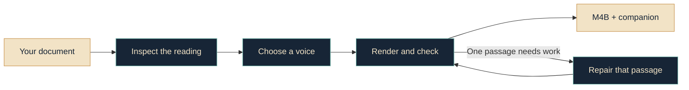

<p align="center">
  
</p>

<h1 align="center">hamr</h1>

<p align="center"><strong>Let your books change shape.</strong></p>
<p align="center">Local documents. Extraordinary voices. A story you can take with you.</p>

<p align="center">
  <a href="https://github.com/MimirLab/hamr/releases/latest"></a>
  
  
  <a href="LICENSE"></a>
</p>

<p align="center">
  <a href="#your-first-book">Make a book</a> ·
  <a href="#a-little-theatre-for-your-library">Meet the cast</a> ·
  <a href="docs/USAGE.md">The field guide</a> ·
  <a href="https://github.com/MimirLab/hamr/releases/latest">Downloads</a>
</p>

Imagine a nature book with Nigel Thornberry's enthusiasm. A journey through the cosmos with Carl Sagan. A perfectly ordinary manual entrusted to Cave Johnson, which may be a questionable management decision.

**hamr turns your EPUB, Markdown and PDF documents into local audiobooks.** Choose a narrator from the built-in cast or bring a clean voice reference of your own. Inspect the reading, render with Breeze TTS2, and leave with a chaptered M4B and a companion that shows where the words came from.

It is built for the whole journey: the first delightful sentence, the three-hour chapter, the interruption halfway through, and the one line you want another take of.

## A story can wear another shape

*Hamr* is an Old Norse word for skin or shape. In the sagas, changing one's *hamr* means taking another form. In *Ynglinga saga*, Odin's body rests while he travels in the shape of another creature. [Dictionary](https://www.germanic-lexicon-project.org/html/oi_cleasbyvigfusson/b0236.html) · [Saga, chapter 7](https://sacred-texts.com/book/heimskringla-or-the-chronicle-of-the-kings-of-norway/the-ynglinga-saga).

That is the idea here. A written story takes on an audible presence. The voice changes; the work deserves to keep its identity, its details, its odd little turns of phrase.

**A new form for the telling. Care for what is being told.**

## Under the feathers

| What you bring | What hamr does with it |
| --- | --- |
| A book, a paper, a field guide, a lovingly overcomplicated manual | Reads EPUB, Markdown and PDF into an inspectable narration plan with source locations. |
| A voice you want to spend time with | Provides 45 bundled character/narrator presets, plus custom voice cloning and voice design. |
| Numbers, abbreviations, notes and awkward document structure | Applies explicit reading rules and listening policies. Ambiguity becomes a review item. |
| A long rendering session | Saves committed audio takes and receipts, then reuses verified work when you resume. |
| One unfortunate performance | Offers a targeted retake or source/pronunciation repair while preserving reusable takes and prior publications. |
| A desire to know what actually happened | Produces a chaptered audiobook, timed companion, source lookup, reports and checksums. |

Document preparation follows deterministic rules. Speech is generated by Breeze through the pinned Hoppou backend. Saved jobs retain their source bytes, narrator reference, model settings and narration rules, so recovery has something solid to return to.



## A little theatre for your library

All **45 voices are part of the application**. Each carries one final reference recording and its exact transcript/metadata. You can hear those references before downloading a speech model.

| Pull up a chair for… | A possible evening's reading | Hear the reference |
| --- | --- | --- |
| **Nigel Thornberry** | A field guide with a great deal of enthusiasm | [Listen](https://raw.githubusercontent.com/MimirLab/hamr/main/src/audiobook/cast_assets/nigel-thornberry/reference.wav) |
| **Carl Sagan** | Something vast enough to make you forget to check your phone | [Listen](https://raw.githubusercontent.com/MimirLab/hamr/main/src/audiobook/cast_assets/carl-sagan/reference.wav) |
| **Cave Johnson** | Instructions from a laboratory with an exciting insurance history | [Listen](https://raw.githubusercontent.com/MimirLab/hamr/main/src/audiobook/cast_assets/cave-johnson/reference.wav) |
| **Garak** | A memoir in exceptionally interesting company | [Listen](https://raw.githubusercontent.com/MimirLab/hamr/main/src/audiobook/cast_assets/garak/reference.wav) |
| **The Stanley Parable Narrator** | An adventure in which you will surely follow the instructions | [Listen](https://raw.githubusercontent.com/MimirLab/hamr/main/src/audiobook/cast_assets/the-stanley-parable-narrator/reference.wav) |
| **Dale Gribble** | A document whose footnotes may require further investigation | [Listen](https://raw.githubusercontent.com/MimirLab/hamr/main/src/audiobook/cast_assets/dale-gribble/reference.wav) |

Pick the company that makes the next chapter irresistible. The complete cast guide has all 45 voices, listening samples, and a few ideas for the kinds of stories they might take you through.

```sh
hamr voice cast
hamr voice sample nigel-thornberry --play
hamr voice select nigel-thornberry
```

**[Explore the complete cast →](docs/CAST.md)**

You can also supply a clean 2–30 second reference with its exact transcript:

```sh
hamr voice clone my-narrator --reference clean.wav --transcript-file exact.txt
```

## Your first book

Bring Python 3.12+, [uv](https://docs.astral.sh/uv/getting-started/installation/), FFmpeg/ffprobe and mpv. hamr is Linux-first. Planning and reference playback do not need a GPU; speech rendering uses an explicitly selected backend profile.

**1. Bring the workshop home.**

```sh
git clone https://github.com/MimirLab/hamr.git
cd hamr
uv build --wheel
./install.sh
hamr doctor --json
```

**2. Meet a narrator.**

```sh
hamr voice sample nigel-thornberry --play
hamr voice select nigel-thornberry
```

**3. Prepare the speech engine.** This explicitly acquires the pinned runtime/model and checks startup. For the Vulkan F16 profile:

```sh
hamr setup --profile vulkan-f16
```

`hamr profiles` lists the catalog. The [setup guide](docs/USAGE.md#install-and-setup) has the details for other backend choices.

**4. Look at the reading, then make the book.**

```sh
hamr plan 'My book.epub' --json
mkdir -p ~/Audiobooks
hamr open 'My book.epub' --output ~/Audiobooks
```

The saved narrator is selected automatically. `open` shows the plan and asks before starting. For explicit headless work, use `queue` or `open --yes`; unresolved source or speech findings still hold publication for review.

**5. Take it with you.**

```sh
hamr status
hamr play JOB
```

Your ready folder contains `book.m4b`, the original source, source lookup HTML, a timed companion, a report and a checksum manifest. Copy the M4B to your audiobook player; keep the companion when you want to follow the trail back to the page.

## The raven keeps your place

Long books take time. Computers have opinions about this.

hamr keeps committed takes with checksummed receipts. After an interruption, inspect the job and resume it. Verified cached work is reused; unfinished work is retried. An interrupted job is recovered explicitly after a reboot.

```sh
hamr status JOB --json
hamr resume JOB
```

If one passage needs another performance:

```sh
hamr repair JOB --retake u00042
hamr resume JOB
```

You can also repair a pronunciation, correct one verified source passage, or rebuild packaging. Repairs preserve prior publications and reuse unaffected audio. Required speech checks and listening findings stay attached to the work until resolved.

For longer unattended runs, `hamr run` combines rendering with configured offline speech recognition and publication gates. The [field guide](docs/USAGE.md#unattended-speech-and-verification) covers observers, resident models, queues and review.

## The words matter

A missing *not* changes a sentence. A missing decimal changes a dose. A dropped line changes a story.

hamr keeps exact source material in the companion, treats content questions as reviewable locations, and supports offline ASR checks against planned speech. Listen, study and procedure modes give notes, references, code and tables different explicit reading policies.

A story can be strange, funny, difficult or wonderfully particular. The aim is to give it a voice while caring about the details that make it itself. The [field guide](docs/USAGE.md) explains the reading and review controls; [release notes](RELEASE.md) record what has been checked.

## Your library stays with you

Ordinary planning, rendering and recovery use local files and local models. Model acquisition happens through explicit setup. Books, job databases and personal review material stay outside the product repository and its release archives.

Fresh installations use `~/.local/share/hamr`; `--home` or `HAMR_HOME` selects another state directory. Existing installations retain owned legacy state and pinned paths. The `audiobook` command remains available as a compatibility alias.

## Help the shapechanger grow

Try a document. Listen closely. Tell us the source location, expected reading and what you actually heard. A precise small failure is an excellent place to make the engine better.

```sh
uv sync --frozen --extra test
uv run pytest -q
uv build
python3 tools/check_release.py
```

[Open an issue](https://github.com/MimirLab/hamr/issues/new) · [Command and recovery guide](docs/USAGE.md) · [Cast catalogue](docs/CAST.md) · [Release evidence](RELEASE.md)

<p align="center">
  
</p>
<p align="center"><em>Every book has somewhere else to take you.</em></p>
<p align="center"><sub><a href="docs/ARTWORK.md">On the name and the artwork</a></sub></p>
